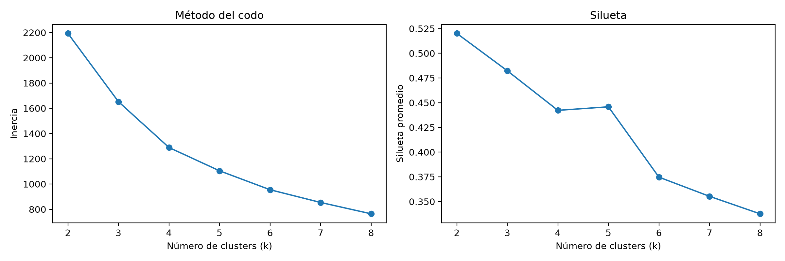
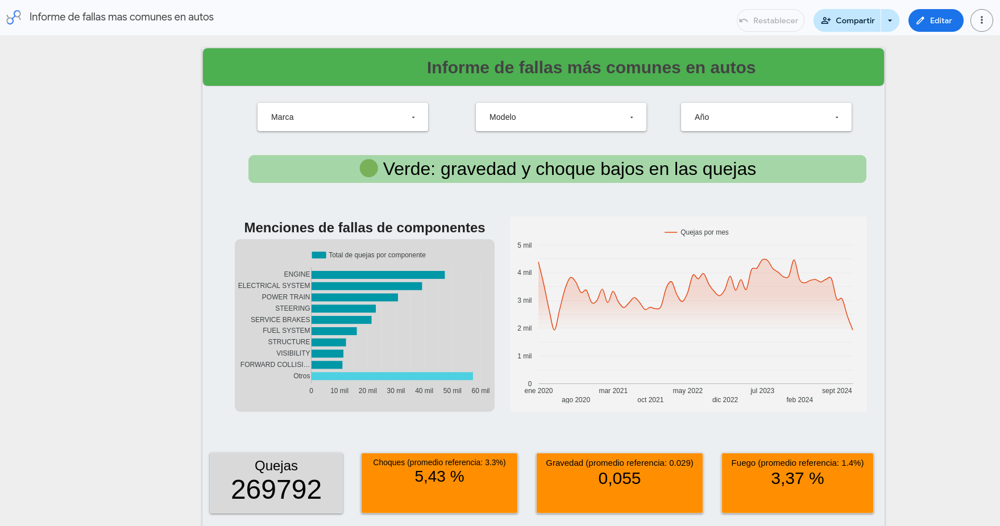

# PIA: Riesgo de quejas por marca, modelo y año
## Minería de Datos | Dataset: NHTSA Consumer Complaints (2020–2024)

## 1. Objetivo

Agrupar las combinaciones marca-modelo-año del dataset de quejas de la NHTSA en niveles de riesgo (un semáforo) y presentarlos en un dashboard para alguien que quiere comprar un auto usado. Como la columna `COMP_MAIN` está vacía en muchas quejas, primero se entrenó un clasificador de texto para rellenarla a partir de `CDESCR`.

## 2. Datos

Se usó `nhtsa_clean.csv` con estas columnas: `ODINO`, `MAKETXT`, `MODELTXT`, `YEARTXT`, `FAILDATE`, `COMP_MAIN`, `CDESCR`, `CRASH`, `FIRE`, `INJURED`, `DEATHS`, `VEH_SPEED` y `MILES`.

Las quejas son reportes de consumidores, no tasas de falla: no hay datos de ventas ni de flota, así que el análisis mide la gravedad de las quejas registradas, no la probabilidad de que un auto falle.

## 3. Estructura del repositorio

```
PIA/
├── main.py                  # corre todo el flujo en orden
├── scripts/
│   ├── rutas.py             # rutas compartidas
│   ├── 01_preparar.py
│   ├── 02_modelo.py
│   ├── 03_comparar.py
│   ├── 04_rellenar.py
│   ├── 05_revisar.py
│   ├── 06_riesgo.py
│   ├── 07_hallazgo.py
│   ├── 08_dashboard.py
│   └── herramientas/        # consulta, ejemplos, referencias, verificar
├── resultados/              # reportes del modelo, revisión manual, hallazgo
├── dashboard/               # CSV que se cargan a Data Studio
├── img/
└── intermedios/             # pickles y modelos (no se suben a git)
```

## 4. Metodología

### 4.1 Preparación

`01_preparar.py` unifica `COMMUNICATIONS` con `COMMUNICATION`, pasa `CRASH` y `FIRE` a 0/1 y agrupa por `ODINO` para obtener una fila por queja con el conjunto de componentes. Se quita `UNKNOWN` de esos conjuntos y se eliminan los componentes con 100 quejas o menos.

| Concepto | Quejas |
|---|---|
| Total | 289,562 |
| Sin componente | 21,492 |
| Con componente | 268,070 |
| Con componente tras el filtro | 267,862 |

### 4.2 Clasificador de componentes (técnica 1)

Clasificación multietiqueta: `MultiLabelBinarizer` para las etiquetas, `TfidfVectorizer` sobre `CDESCR` y `OneVsRestClassifier(LinearSVC)`. Se entrenaron dos versiones, sin balancear y balanceada.

| Métrica | Sin balancear | Balanceada |
|---|---|---|
| Precisión (micro) | 0.83 | 0.51 |
| Recall (micro) | 0.61 | 0.81 |
| F1 (micro) | 0.71 | 0.63 |
| F1 (macro) | 0.60 | 0.51 |

Se usó el modelo sin balancear.

### 4.3 Relleno de `COMP_MAIN`

`04_rellenar.py` conserva el componente original y completa el faltante con la predicción del modelo; si el modelo no predice nada, fuerza la etiqueta de mayor puntaje. La columna `ORIGEN` registra de dónde viene cada valor.

| ORIGEN | Quejas |
|---|---|
| Original | 268,070 |
| Predicho | 15,239 |
| Forzado | 6,253 |

Revisión manual de una muestra (`05_revisar.py`): 8 de 100 predichas y 16 de 50 forzadas no tenían nada que ver con la descripción.

### 4.4 Niveles de riesgo (técnica 2)

K-Means con K=4 sobre las combinaciones marca-modelo-año, con variables estandarizadas con `StandardScaler`. Se eligió K con codo y silueta (`img/codo_silueta_riesgo.png`). Los grupos se nombraron como semáforo.



| Nivel | Combinaciones | Quejas por combinación (promedio) |
|---|---|---|
| Verde | 707 | 210.7 |
| Amarillo | 244 | 133.7 |
| Rojo | 29 | 85.1 |
| Alerta de fuego | 119 | 165.9 |
| Sin datos | 9,135 | |

Promedios de las tasas por nivel (en el mismo orden: choque, lesionados, fuego):

| Nivel | Choque | Lesionados | Fuego |
|---|---|---|---|
| Verde | 0.019 | 0.024 | 0.008 |
| Amarillo | 0.063 | 0.076 | 0.012 |
| Rojo | 0.182 | 0.163 | 0.025 |
| Alerta de fuego | 0.034 | 0.031 | 0.069 |

Cada nivel resume la gravedad de las quejas registradas para una combinación marca-modelo-año:

- **Verde** (707 combinaciones): las tasas más bajas de choque (0.019), lesionados (0.024) y fuego (0.008). Es el grupo con más quejas por combinación (210.7), así que muchas quejas no implican quejas graves.
- **Amarillo** (244): tasas intermedias, con choque en 0.063 y lesionados en 0.076.
- **Rojo** (29): las tasas más altas de choque (0.182) y lesionados (0.163).
- **Alerta de fuego** (119): choque y lesionados cercanos a Verde (0.034 y 0.031), pero la tasa de fuego más alta (0.069).
- **Sin datos** (9,135): combinaciones sin información suficiente para asignarles nivel.

Los niveles describen la gravedad de las quejas, no la probabilidad de que un auto falle.

### 4.5 Prueba estadística

`07_hallazgo.py` aplica Kruskal-Wallis a 28 componentes entre los niveles, con corrección de Holm para los p-values y tamaño de efecto ε² = H/(n−1). Se marcan para mencionar los componentes con ε² ≥ 0.06.

| Componente | H | ε² | p ajustado |
|---|---|---|---|
| AIR BAGS | 110.4 | 0.101 | 2.5e-22 |
| FORWARD COLLISION AVOIDANCE | 105.9 | 0.096 | 2.3e-21 |
| FIRERELATED | 103.2 | 0.094 | 8.2e-21 |
| ENGINE | 84.3 | 0.077 | 9.0e-17 |
| SEAT BELTS | 71.7 | 0.065 | 4.5e-14 |

### 4.6 Dashboard

Dashboard en Data Studio con una sola fuente (`dashboard.csv`, 76,773 filas × 18 columnas). Enlace: https://datastudio.google.com/reporting/226addaa-9c08-432d-88c9-bb28a82a7a86



Se incluyen valores de referencia (`referencias.csv`): 0.0285 como promedio general, 3.3% y 1.4%. Las quejas con componente en la referencia son 203,776, el 75.5% del total.

## 5. Hallazgo

El resultado no es un solo hallazgo, sino una clasificación de cada marca-modelo-año en un semáforo de riesgo para quien va a comprar un auto usado. De ahí salen varias lecturas:

- La mayoría de las combinaciones con datos cae en Verde (707 de 1,099), y solo 29 en Rojo.
- Un año de un modelo puede estar en Verde y el siguiente en Amarillo o Rojo, así que conviene revisar el año y no solo el modelo.
- Alerta de fuego separa un riesgo distinto: sus choques y lesionados son bajos, pero la tasa de fuego es la más alta (0.069), por lo que un auto puede verse tranquilo en gravedad y aun así tener ese problema.
- Más quejas no significa más grave: Verde tiene el promedio más alto de quejas por combinación (210.7) y Rojo el más bajo (85.1).
- Los niveles se comparan por componente con Kruskal-Wallis (sección 4.5), para ver en qué parte del auto se concentran las diferencias.

## 6. Conclusiones

El clasificador permitió recuperar el componente de las 21,492 quejas que no lo tenían, a partir del texto que dejaron los consumidores. Se eligió el modelo sin balancear (precisión micro 0.83, recall 0.61) porque se prefirió no rellenar un campo por rellenarlo. Aun así, el relleno forzado de 6,253 quejas se aceptó para tener el campo completo, aunque en la revisión manual 16 de 50 no tenían relación con la descripción. Los componentes rellenados son una aproximación.

El semáforo separa las combinaciones marca-modelo-año por la gravedad de sus quejas, no por su cantidad. Verde tiene el promedio más alto de quejas por combinación (210.7) y Rojo el más bajo (85.1). Una hipótesis, que no se probó, es que cuando hay muchas quejas unas pocas graves pesan menos en el promedio, y cuando hay pocas una sola grave lo mueve mucho.

Para quien va a comprar, el dashboard sirve como respaldo, no como decisión final. Si hay duda entre dos modelos, conviene revisar cuál está en Verde y cuál en Amarillo, Rojo o Alerta de fuego, y qué componentes concentran sus quejas. Hay que recordar que el nivel mide la gravedad de las quejas registradas, no la probabilidad de falla, y que un auto ausente del dashboard no es necesariamente seguro.

Los componentes que más cambian entre niveles (AIR BAGS, FORWARD COLLISION AVOIDANCE, FIRERELATED, ENGINE y SEAT BELTS) están relacionados con choques o con incendios, que son las variables con las que se formaron los niveles. Por eso esa parte del resultado era esperable y confirma que los grupos se comportan de forma coherente, pero no aporta información independiente sobre qué falla en cada nivel.

## 7. Limitaciones

- Una queja es un reporte de un consumidor, no una falla confirmada. No hay datos de ventas ni de flota, así que un auto muy vendido acumula más quejas sin ser peor. El semáforo mide gravedad de las quejas registradas, no probabilidad de falla.
- 9,135 combinaciones quedaron "Sin datos" y no tienen nivel.
- Parte de `COMP_MAIN` se rellenó con el clasificador: 15,239 quejas predichas y 6,253 forzadas. En la revisión manual, 8 de 100 predichas y 16 de 50 forzadas no tenían relación con la descripción.
- El clasificador sin balancear tiene recall micro de 0.61, por lo que se le escapan componentes.
- K-Means siempre devuelve K grupos, existan o no en los datos; K=4 se eligió con codo y silueta, pero los límites entre niveles son una decisión del método.
- El clasificador se entrenó sin `random_state`; por eso `main.py` salta ese paso y reutiliza el modelo guardado.
- Las diferencias entre niveles en las variables con las que se formaron los grupos (choque, lesionados, fuego) son esperables por construcción. Solo las diferencias por componente son una comparación independiente.
- Solo aparecen combinaciones marca-modelo-año con quejas en el dataset (NHTSA, 2020–2024). Un auto que no se vendió en Estados Unidos no estará, y uno poco común tendrá pocas quejas o ninguna. Un modelo muy reciente lleva poco tiempo en circulación y acumula pocas quejas, así que su nivel puede verse mejor o peor de lo que será con más tiempo. La ausencia de un auto en el dashboard no significa que sea seguro.

## 8. Cómo ejecutar

Dependencias: `pandas`, `numpy`, `scikit-learn`, `scipy`, `statsmodels`, `matplotlib` y `joblib`.

Desde la carpeta `PIA/`:

```
python3 main.py
python3 scripts/herramientas/verificar.py
```

`main.py` corre los ocho scripts en orden y se detiene si uno falla. Por defecto salta `02_modelo`, porque entrenar sin `random_state` daría un modelo ligeramente distinto en cada corrida; los modelos guardados en `intermedios/` se reutilizan. Para reentrenar, quita `02_modelo` del conjunto `SALTAR` en `main.py`.

`verificar.py` revisa que las salidas existan y sean consistentes e imprime `ok` o `FALLA` por cada una.

## 9. Video

https://youtu.be/_rHEjH6_4kQ

## 10. Nota sobre uso de IA

Este proyecto se desarrolló bajo la modalidad de Pair Programming (Conductor/Navegante) permitida por el curso: la lógica y las decisiones fueron mías; la IA se usó para depurar errores, sugerir librerías y sintaxis, y hacer preguntas guía sobre cómo leer los resultados. Los hallazgos y conclusiones son míos.
