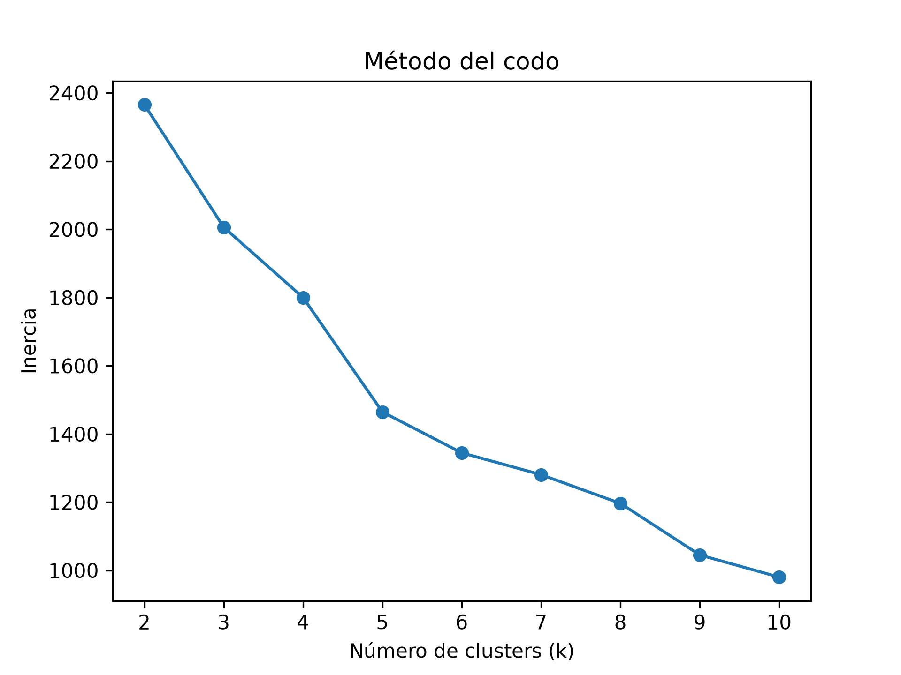
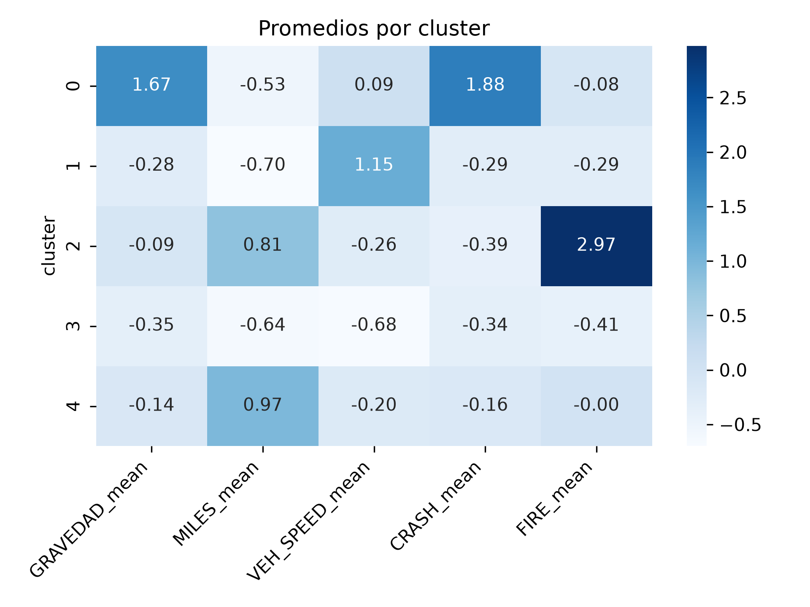
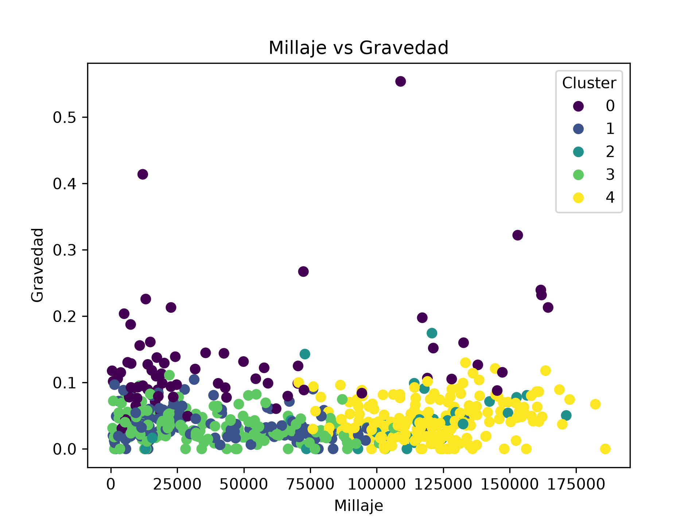
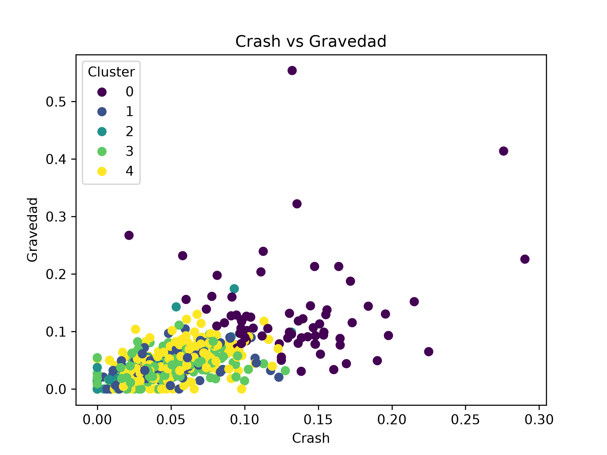

# Práctica 7 — Agrupamiento de Datos (K-Means)
## Minería de Datos | Dataset: NHTSA Consumer Complaints (2020–2024)

## 1. Objetivo

Crear y evaluar un modelo de agrupamiento con K-Means. En vez de agrupar quejas individuales, se planteó una pregunta con utilidad práctica para un público no técnico: ¿existen "perfiles de riesgo" naturales entre combinaciones de marca y año-modelo de vehículo, a partir de cómo se comportan sus incidentes reportados (gravedad, choques, incendios, millaje y velocidad al momento de la falla)? La idea es que alguien evaluando la compra de un auto usado pueda ubicar una combinación marca/año dentro de uno de esos perfiles.

## 2. Selección de variables y preparación de datos

### 2.1 — Filtro por año de incidente

Se usó `FAILDATE` (fecha del incidente, según el diccionario de campos) para filtrar solo quejas reportadas entre 2020 y 2025, descartando años anteriores con menos volumen de datos.
### 2.2 — Variables usadas

Se evaluó la proporción/variación de 5 variables candidatas antes de decidir incluirlas, con el mismo criterio usado en la Práctica 6 (descartar columnas con 99%+ de concentración en un solo valor):

| Variable | Proporción en 0 / valor dominante | ¿Se incluye? |
|---|---|---|
| CRASH | 95.5% N, 4.5% Y | Sí |
| FIRE | 98% N, 2% Y | Sí |
| MILES | 3% exactamente 0 (entre datos no nulos) | Sí |
| VEH_SPEED | 21.3% exactamente 0 (entre datos no nulos) | Sí |
| GRAVEDAD (INJURED + DEATHS) | 97.28% exactamente 0 | Sí (se mantiene pese a la alta concentración, porque en términos absolutos sigue representando decenas de miles de casos reales) |

`CRASH` y `FIRE` se convirtieron a binario (1/0) igual que en la Práctica 6. `GRAVEDAD` se construyó sumando `INJURED + DEATHS`.

Sobre los nulos de `MILES` (253,089) y `VEH_SPEED` (160,942): se decidió no aplicar `dropna()` general, porque eliminaría filas completas que sí tenían dato válido en las demás columnas. En su lugar, se dejaron los nulos sin tratar y se aprovechó que `groupby().mean()` los excluye automáticamente del cálculo por columna, sin descartar la fila entera.

### 2.3 — Unidad de agrupamiento

A diferencia de la Práctica 6 (donde cada fila era una queja individual), aquí cada "punto" que entra al K-Means es una combinación `MAKETXT` + `YEARTXT` (marca + año-modelo), resumida mediante `groupby(['MAKETXT', 'YEARTXT']).agg(...)` en el promedio de sus 5 variables (más un conteo de registros por grupo). Se filtraron las combinaciones con menos de 50 quejas de respaldo, para evitar que un grupo con 2 o 3 registros (cuyo promedio no es confiable) distorsionara el resultado. Quedaron 589 combinaciones marca+año.

## 3. Escalado

Se aplicó `StandardScaler` sobre las 5 columnas de promedios (excluyendo el conteo usado solo para el filtro), por la misma razón que en KNN: K-Means agrupa por distancia entre puntos, y sin escalar, una variable como `MILES_mean` (valores en cientos de miles) dominaría por completo el cálculo frente a variables como `CRASH_mean` (valores entre 0 y 1).

## 4. Elección de k — Método del codo

Se corrió K-Means con k de 2 a 10 y se graficó la inercia (suma de distancias al cuadrado entre cada punto y el centro de su cluster) de cada corrida. La inercia baja de forma pronunciada hasta k=5, punto donde la pendiente se aplana notablemente — ese cambio de ritmo es el "codo" que marca el punto donde agregar más clusters deja de aportar una mejora significativa en compactación, a cambio de más complejidad para interpretar. Se eligió **k=5**.

## 5. Resultados

### 5.1 — Perfil de cada cluster (valores originales)

| Cluster | Gravedad prom. | Millaje prom. | Velocidad prom. | Tasa choques | Tasa incendios |
|---|---|---|---|---|---|
| 0 | 0.129 | 46,169 | 32.3 | 0.132 | 0.022 |
| 1 | 0.036 | 37,898 | 39.2 | 0.044 | 0.016 |
| 2 | 0.045 | 111,681 | 30.1 | 0.039 | 0.114 |
| 3 | 0.032 | 40,729 | 27.4 | 0.041 | 0.012 |
| 4 | 0.043 | 119,316 | 30.5 | 0.049 | 0.024 |

### 5.2 — Interpretación de cada cluster

- **Cluster 0 — Alto riesgo:** gravedad y tasa de choques notablemente más altas que los demás grupos (0.129 y 0.132 respectivamente, ambas muy por encima de los otros 4 clusters), yendo de la mano entre sí — tiene sentido que las combinaciones con más choques también concentren los incidentes más graves.
- **Cluster 1:** millaje bajo pero la velocidad promedio más alta de los 5 (39.2), sin que eso se traduzca en mayor gravedad (0.036, de las más bajas) — incidentes a mayor velocidad pero de menor consecuencia en promedio.
- **Cluster 2:** millaje alto (111,681) y la tasa de incendios más alta de los 5 (0.114), pero tasa de choques y gravedad bajas — un perfil de "alto kilometraje con riesgo de incendio" distinto al de choques.
- **Cluster 3 — Bajo riesgo:** valores bajos en las 5 variables, el perfil más "tranquilo" del conjunto.
- **Cluster 4:** el millaje más alto de los 5 (119,316), pero gravedad, choques e incendios moderados-bajos — alto kilometraje sin que eso implique mayor riesgo.

### 5.3 — Visualizaciones

En ambas gráficas de dispersión, el cluster 0 se distingue extendiéndose hacia valores más altos de gravedad y de tasa de choques que los demás clusters, aunque en la zona de valores bajos los 5 colores se mezclan bastante — es esperable, ya que estas gráficas solo muestran 2 de las 5 dimensiones que el modelo usó para agrupar; el heatmap de promedios escalados (sección 5.1) da una lectura más completa y confiable de cómo se diferencian los 5 clusters en conjunto.

## 6. Marcas en cada perfil

Para conectar los clusters con marcas reales, se contó cuántas combinaciones marca-año cayeron en cada uno. En total son 589 combinaciones: 72 en el cluster 0 (mayor riesgo) y 151 en el cluster 3 (menor riesgo). Se muestran las 10 marcas con más combinaciones en cada uno, junto con el total de combinaciones de la marca y la proporción que cae en el cluster.

### Cluster 0

| Marca | En el cluster | Total de la marca | Proporción |
|---|---|---|---|
| Lexus | 12 | 19 | 63% |
| Toyota | 6 | 25 | 24% |
| BMW | 5 | 23 | 22% |
| Mitsubishi | 4 | 8 | 50% |
| Cadillac | 3 | 19 | 16% |
| Honda | 3 | 28 | 11% |
| Lincoln | 3 | 17 | 18% |
| Mazda | 3 | 17 | 18% |
| Mercedes Benz | 3 | 23 | 13% |
| Volvo | 3 | 14 | 21% |

### Cluster 3

| Marca | En el cluster | Total de la marca | Proporción |
|---|---|---|---|
| Volkswagen | 11 | 19 | 58% |
| Cadillac | 8 | 19 | 42% |
| Land Rover | 8 | 13 | 62% |
| Subaru | 8 | 20 | 40% |
| Buick | 7 | 17 | 41% |
| Lincoln | 7 | 17 | 41% |
| Audi | 6 | 14 | 43% |
| Chevrolet | 6 | 26 | 23% |
| Dodge | 6 | 21 | 29% |
| GMC | 6 | 19 | 32% |

Entre las marcas con al menos 8 combinaciones, Lexus (63%) y Mitsubishi (50%) son las que más concentran sus años en el cluster 0. En el cluster 3, Land Rover (62%) y Volkswagen (58%) son las de mayor concentración entre las que tienen al menos 13.

Algunas precauciones al leer las tablas:

- La unidad es la combinación marca-año, no la marca. Una misma marca puede tener años en clusters distintos: Cadillac, Lincoln, Honda y Mazda aparecen tanto en el cluster 0 como en el 3.
- Las marcas con pocas combinaciones dan proporciones altas con poca base. Por ejemplo, Rivian tiene sus 2 combinaciones en el cluster 0, y en el cluster 3 hay marcas con 1 de 1 (Polestar, Fisker, Keystone).
- Cada perfil describe las quejas reportadas de esa combinación, no la probabilidad de que un auto de esa marca y año falle. Una marca con más quejas graves en el dataset no implica necesariamente más fallas en la población de autos que circulan.

## 6. Limitaciones

Las gráficas de dispersión de 2 variables no reflejan completamente cómo se separaron los clusters, ya que el modelo agrupó considerando las 5 variables a la vez — dos puntos pueden verse cercanos en un plano de 2 dimensiones y pertenecer a clusters distintos por estar lejos entre sí en otra de las variables no graficadas.

La elección de k=5 se basó en lectura visual del método del codo, no en un criterio numérico adicional (como silhouette score), que podría usarse en una iteración futura para confirmar o ajustar esta elección.

Los promedios de cada grupo marca+año se calcularon solo sobre quejas reportadas entre 2020 y 2025, por lo que el "perfil de riesgo" de una combinación refleja su comportamiento reciente, no necesariamente toda su historia.

## 7. Nota sobre uso de IA

Este código se desarrolló bajo la modalidad de Pair Programming (Conductor/Navegante) permitida por el curso: la lógica y las decisiones fueron mías; la IA se usó para depurar errores puntuales, sugerir sintaxis o librerías (groupby con múltiples columnas, aplanado de MultiIndex, StandardScaler aplicado a datos agrupados), y hacer preguntas guía sobre cómo leer el método del codo y la tabla de promedios por cluster. Ningún hallazgo ni interpretación final salió de la IA sin pasar antes por esa verificación directa contra los datos.
