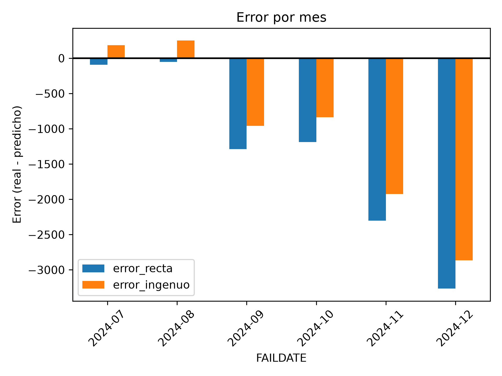
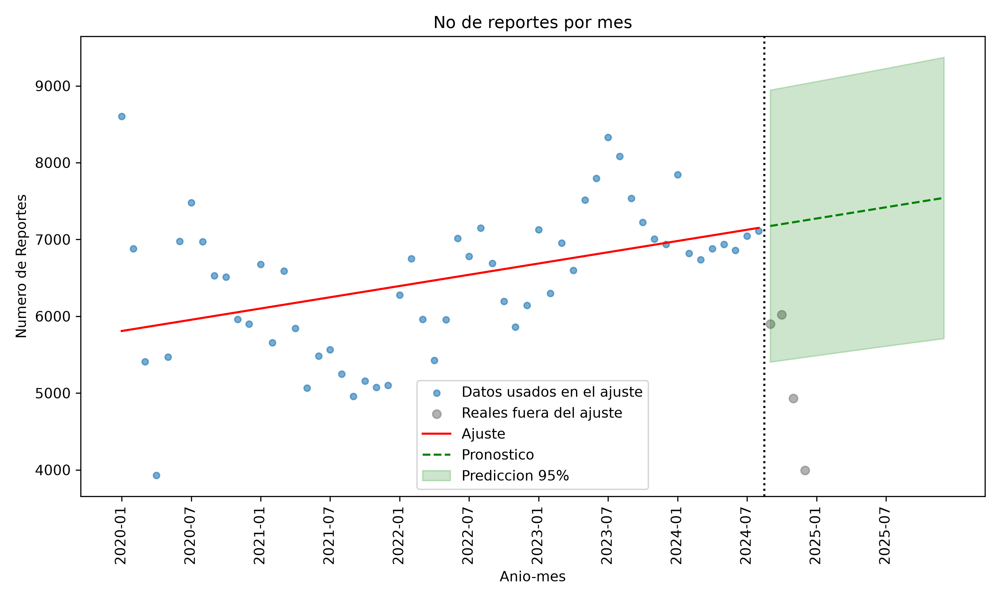

# Práctica 8: Pronóstico (Forecasting)
## Minería de Datos | Dataset: NHTSA Consumer Complaints (2020–2024)

## 1. Objetivo

Crear un modelo de regresión sobre una serie de tiempo para predecir datos futuros. La serie es el número de quejas por mes, la misma que se usó en el Modelo 3 de la Práctica 5, y el pronóstico cubre los 12 meses de 2025. 

## 2. Serie y variables

Se contaron las quejas por mes según `FAILDATE` (fecha del incidente), de enero de 2020 a diciembre de 2024, lo que da 60 meses. Se usó el mes como unidad. Se parte de 2020 por el salto en el volumen de quejas que se vio en esa misma práctica.

El tiempo entra al modelo como un índice secuencial `x` (0 para enero de 2020, 59 para diciembre de 2024) y la variable a predecir es el número de quejas del mes. El modelo es una regresión lineal con `statsmodels.OLS` y constante.

## 3. Validación

A diferencia de la Práctica 6, la división en ajuste y prueba es cronológica y no aleatoria: mezclar meses haría que el modelo se entrenara con datos posteriores a los que debe predecir.

| Conjunto | Meses | Periodo |
|---|---|---|
| Ajuste | 54 | enero de 2020 a junio de 2024 |
| Prueba | 6 | julio a diciembre de 2024 |

Recta ajustada con los 54 meses: `y = 5803.43 + 24.67x`.

Como métrica se usó el MAE (error absoluto medio), que se expresa en quejas por mes. Para darle contexto se calculó el MAE de un modelo ingenuo que no usa tendencia: repite en los seis meses de prueba el último valor del ajuste (junio de 2024, 6,858 quejas).

| Mes | Real | Recta | Error recta | Ingenuo | Error ingenuo |
|---|---|---|---|---|---|
| 2024-07 | 7,044 | 7,136 | -92 | 6,858 | +186 |
| 2024-08 | 7,108 | 7,160 | -52 | 6,858 | +250 |
| 2024-09 | 5,898 | 7,185 | -1,287 | 6,858 | -960 |
| 2024-10 | 6,022 | 7,210 | -1,188 | 6,858 | -836 |
| 2024-11 | 4,933 | 7,234 | -2,301 | 6,858 | -1,925 |
| 2024-12 | 3,993 | 7,259 | -3,266 | 6,858 | -2,865 |

El error se calcula como real menos predicho, así que un valor negativo significa que el modelo predijo de más.

| Modelo | MAE |
|---|---|
| Recta | 1,364 |
| Ingenuo | 1,170 |

La recta estuvo más cerca de lo real en julio y agosto, y el modelo ingenuo en septiembre, octubre, noviembre y diciembre. El MAE de la recta resultó mayor que el del ingenuo, por lo que en estos seis meses la tendencia lineal no mejoró a una predicción que solo repite el último valor.

## 4. Caída de septiembre a diciembre de 2024

La mayor parte del error de los dos modelos viene de los últimos cuatro meses, donde la serie real cae mientras la recta sigue subiendo. Para ver si eso se podía atribuir solo a la época del año, se calculó el cambio porcentual de agosto a diciembre en cada año:

| Año | Cambio de agosto a diciembre |
|---|---|
| 2020 | -15.3% |
| 2021 | -2.8% |
| 2022 | -14.1% |
| 2023 | -14.2% |
| 2024 | -43.8% |

En 2020-2023 la serie también baja hacia fin de año, entre 3% y 15%, pero la caída de 2024 es bastante mayor. La época del año explica una parte, no esa magnitud.

Como hipótesis, a septiembre-diciembre de 2024 les pudo haber faltado registrar quejas. No se verificó: no se calculó el rezago entre la fecha del incidente y la fecha de recepción (`dias_reporte`), así que tampoco se descarta que la baja sea real. 
## 5. Modelo final y pronóstico de 2025

Para el pronóstico se reajustó la recta con 56 meses (enero de 2020 a agosto de 2024), dejando fuera septiembre a diciembre de 2024 por la hipótesis anterior. Este corte se decidió después de ver el comportamiento de esos meses en la validación, y así se deja asentado.

| Parámetro | Modelo de 54 meses | Modelo de 56 meses |
|---|---|---|
| Intercepto | 5,803.43 | 5,808.14 |
| Pendiente | 24.67 | 24.41 |

Los parámetros cambian poco entre los dos modelos, por lo que el MAE de la validación se reporta como referencia del modelo final, teniendo presente que se calculó con el de 54 meses.

En la gráfica, los puntos azules son los meses usados en el ajuste, los grises son los cuatro meses reales que quedaron fuera, la línea roja es la recta ajustada y la línea verde punteada es su extensión hacia adelante, con la banda de predicción al 95%. La línea verde empieza en septiembre de 2024 para mostrar qué habría estimado el modelo para esos cuatro meses, y los 12 meses de 2025 son su tramo final.

| Mes | Pronóstico | Límite inferior | Límite superior |
|---|---|---|---|
| 2025-01 | 7,273 | 5,488 | 9,058 |
| 2025-02 | 7,297 | 5,508 | 9,086 |
| 2025-03 | 7,321 | 5,529 | 9,114 |
| 2025-04 | 7,346 | 5,550 | 9,142 |
| 2025-05 | 7,370 | 5,570 | 9,171 |
| 2025-06 | 7,395 | 5,590 | 9,199 |
| 2025-07 | 7,419 | 5,611 | 9,228 |
| 2025-08 | 7,444 | 5,631 | 9,256 |
| 2025-09 | 7,468 | 5,651 | 9,285 |
| 2025-10 | 7,492 | 5,671 | 9,314 |
| 2025-11 | 7,517 | 5,690 | 9,343 |
| 2025-12 | 7,541 | 5,710 | 9,372 |

Los límites son los de predicción individual de cada mes, no los de la recta promedio, y por eso son más anchos. Sumando los valores centrales, el pronóstico para todo 2025 es de aproximadamente 88,900 quejas.

## 6. Conclusiones

La recta estima un crecimiento de unas 24 quejas más por cada mes que pasa. El pronóstico de 2025 va de 7,273 quejas en enero a 7,541 en diciembre, con una banda de predicción de unos 1,800 por encima y por debajo del valor central en cada mes.

En la validación, la recta no superó al modelo ingenuo (MAE de 1,364 contra 1,170). La diferencia se genera de septiembre a diciembre de 2024, el tramo donde la serie real cae mientras la tendencia sigue creciendo. Como esos meses pueden estar incompletos, el error de ambos modelos pudo quedar inflado por un efecto ajeno al modelo.

El pronóstico depende de la decisión de excluir esos cuatro meses del ajuste. Si la caída fuera real y no un registro incompleto, la recta estaría sobrestimando 2025.

## 7. Limitaciones

La regresión lineal simple supone una tendencia constante y no modela estacionalidad. La serie baja hacia fin de año en todos los años revisados, algo que una recta no puede reproducir.

La validación usa solo seis meses de prueba, y justo son los que incluyen la caída de 2024, así que el MAE depende mucho de ese tramo.

El corte de 56 meses se eligió después de observar los resultados de la validación, y el MAE reportado corresponde al modelo de 54 meses.

No se verificó el rezago de reporte, por lo que la explicación de los meses incompletos sigue siendo una hipótesis.

El pronóstico de 2025 no se puede validar porque el archivo no contiene ese año.

## 8. Nota sobre uso de IA

Este código se desarrolló bajo la modalidad de Pair Programming (Conductor/Navegante) permitida por el curso: la lógica y las decisiones fueron mías; la IA se usó para depurar errores puntuales, sugerir sintaxis o librerías (`get_prediction` y `summary_frame` de statsmodels, `mean_absolute_error` de scikit-learn) y hacer preguntas guía sobre cómo validar un pronóstico y qué es un modelo ingenuo. Ningún hallazgo ni interpretación final salió de la IA.
