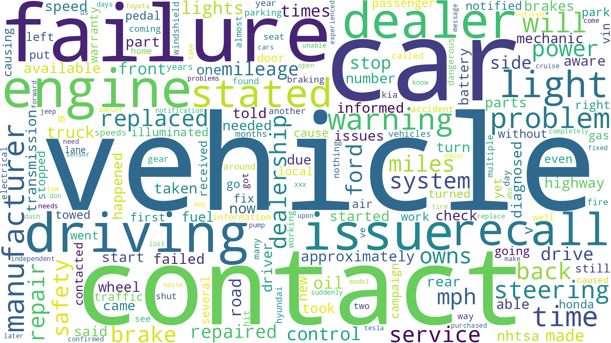
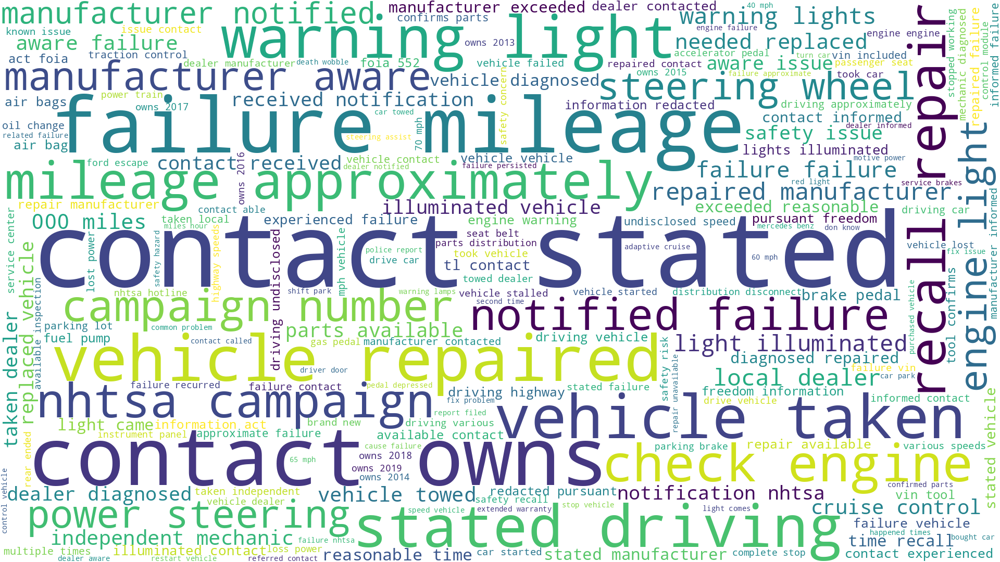
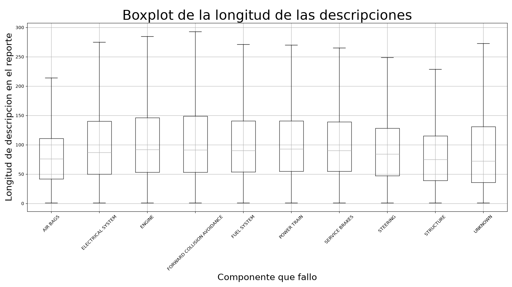

# Práctica 9: Análisis de Texto
## Minería de Datos | Dataset: NHTSA Consumer Complaints (2020–2024)

## 1. Objetivo

Generar una nube de palabras y hacer un análisis exploratorio a partir de la columna de texto del dataset. El texto es la descripción de cada queja (`CDESCR`). Además de la nube de palabras, se hizo una nube de bigramas y una comparación de la longitud de las quejas entre componentes.

## 2. Datos

Se leyeron dos columnas de `nhtsa_clean.csv`: `CDESCR` (texto libre de la queja) y `COMP_MAIN` (componente del vehículo que falló).

La longitud de una queja se midió como el número de palabras que resulta de partir el texto por espacios.

## 3. Metodología

### 3.1 Nube de palabras

El texto se pasó a minúsculas y se separó en palabras con la expresión regular `[a-z]+`. Se contó la frecuencia de cada palabra con `Counter` y, sobre el diccionario de frecuencias, se quitaron las stopwords de la librería `wordcloud` (`STOPWORDS`) y los fragmentos `s` y `t`. La nube se generó con `generate_from_frequencies`, a 1920x1080 píxeles, con fondo blanco y tamaño mínimo de letra de 5.

### 3.2 Nube de bigramas

Los bigramas (pares de palabras seguidas) se contaron con `CountVectorizer` de scikit-learn, con `ngram_range=(2, 2)`, `max_features=5000` y `stop_words='english'`, sobre las descripciones no nulas. Los conteos se sumaron por columna y se pasaron a una nube con la misma configuración que la anterior.

### 3.3 Longitud de las quejas por componente

Se tomaron los 10 componentes con más quejas, `UNKNOWN` incluido, y se dibujó un diagrama de caja de la longitud por componente. En la gráfica se ocultaron los valores extremos (`showfliers=False`).

## 4. Resultados

### 4.1 Nube de palabras



### 4.2 Nube de bigramas



### 4.3 Longitud por componente



## 5. Observaciones

En las dos nubes dominan palabras como `vehicle`, `failure`, `repair`, `contact` y `mileage`. Hablan poco de qué componentes fallan, con algunas excepciones como `steering` (la dirección) y pares como `power steering`, `steering wheel` y `check engine`. En los bigramas también aparecen abreviaciones como `tl` y `000`.

En el boxplot las cajas se parecen mucho entre componentes. `AIR BAGS` y `STRUCTURE` tienen las cajas más pequeñas. Las más altas se ven en `FORWARD COLLISION AVOIDANCE`, `ENGINE` y `ELECTRICAL SYSTEM`. Se esperaba que las descripciones fueran más largas donde hay más que explicar, y esto se cumple solo en parte.

## 6. Conclusiones

El texto de las quejas habla más de cómo se redactan y se tramitan que de qué componente falló, con pocas excepciones como la dirección. La longitud de las descripciones es parecida entre componentes, con diferencias pequeñas.

## 7. Cómo ejecutar

Dependencias: `pandas`, `numpy`, `matplotlib`, `wordcloud` y `scikit-learn`.

El script lee `../data/nhtsa_clean.csv` y guarda las imágenes en `img/` (la carpeta debe existir):

```
python3 main.py
```

Genera `word_cloud.png`, `word_cloud_bigramas.png` y `boxplot.png`.

## 8. Nota sobre uso de IA


Este código se desarrolló bajo la modalidad de Pair Programming (Conductor/Navegante) permitida por el curso: la lógica y las decisiones fueron mías; la IA se usó para depurar errores puntuales, sugerir sintaxis y librerías (`generate_from_frequencies` de `wordcloud`, `CountVectorizer` de scikit-learn, parámetros de `boxplot`) y hacer preguntas guía sobre cómo leer los resultados. Ningún hallazgo ni interpretación final salió de la IA.
